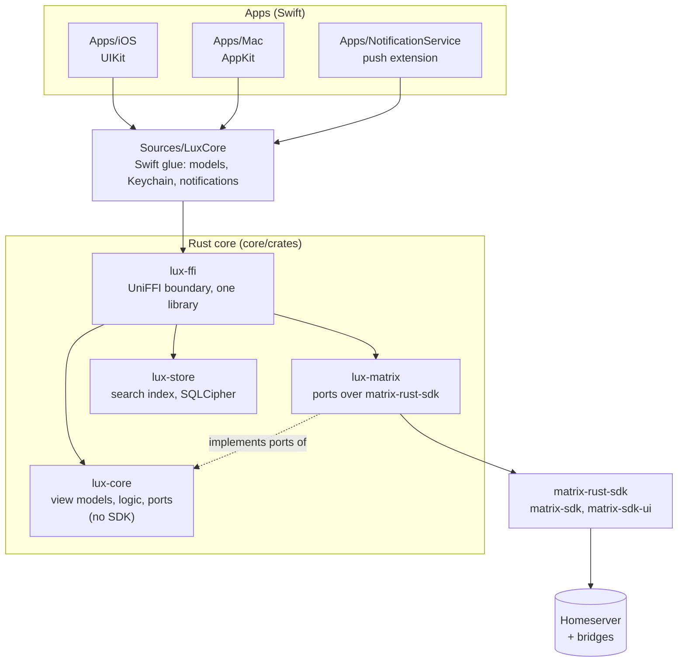
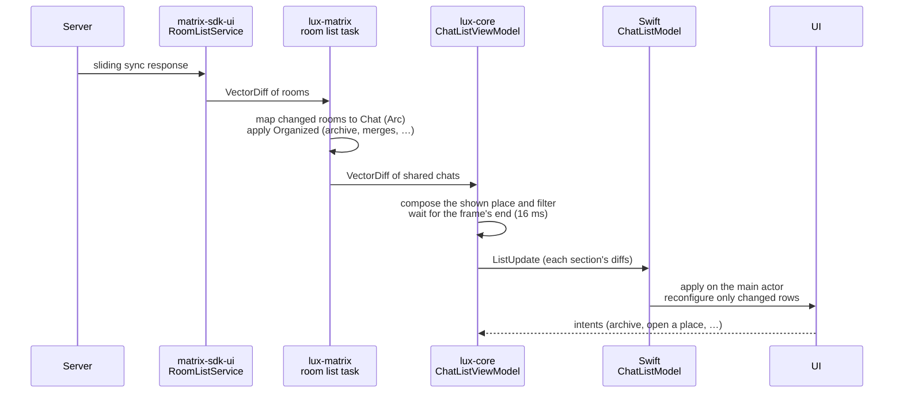
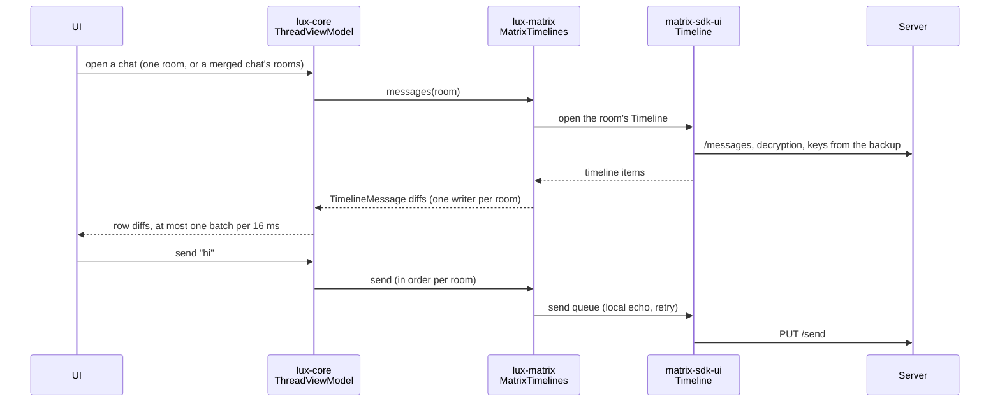
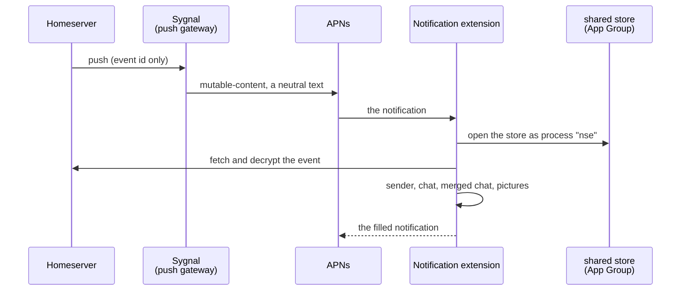
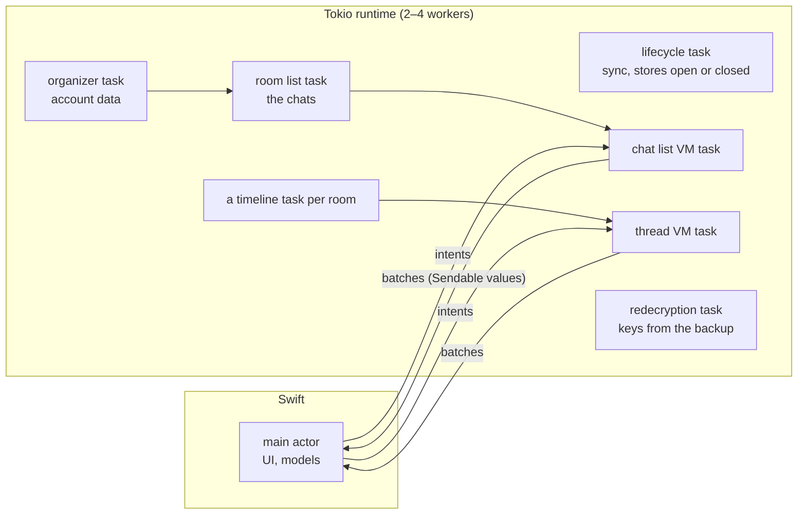
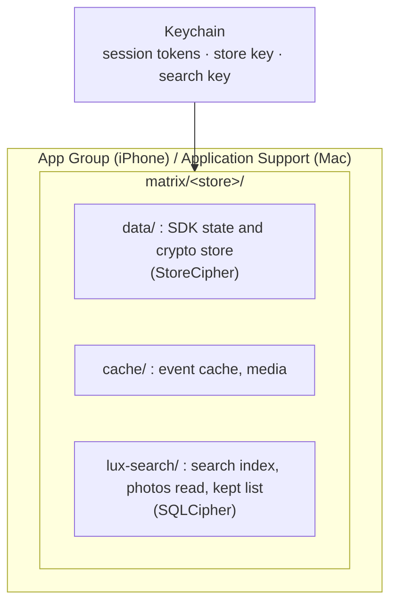

# Architecture

Lux is a native Matrix client. Everything but the UI lives in one Rust core; each platform draws
its own native UI over it (UIKit on iPhone, AppKit on the Mac). Chats from other networks
(WhatsApp, Messenger, Instagram, …) arrive through mautrix bridges on the user's homeserver, so
to the app every chat is a Matrix room.

This page is the way in: the layers, where the code lives, and how data moves. The core's design
rules are in [rust-core.md](rust-core.md), the numbers in [performance.md](performance.md).

## Layers



- **Apps** only draw and forward what the user does. No Matrix logic.
- **Sources/LuxCore** turns the core's batches into Swift values on the main actor and owns
  platform services (Keychain, notifications, background tasks).
- **lux-core** holds the chat list and thread view models and the app's rules. It defines what it
  needs from a backend as traits (*ports*) and never names the SDK, so it builds and tests in
  seconds. A made-up demo account implements the same ports (`-LuxDemo`).
- **lux-matrix** implements the ports with matrix-rust-sdk: sign-in, sync, the room list,
  timelines, push, the account data the app keeps.
- **lux-ffi** is the only Rust library the apps link; only its `Core…` types cross to Swift.

## Where things are

```
lux-native/
├── Apps/
│   ├── iOS/                 iPhone app: App/ (delegate, notifications, background refresh),
│   │                        Features/ (ChatList, Thread, Search, Settings, SignIn, …)
│   ├── Mac/                 Mac app: the same features, plus Rail and Sidebar
│   ├── NotificationService/ iPhone push extension: fills a notification's text and pictures
│   ├── Shared/              compiled into both apps: assets, message styling, network logos
│   └── UITests/             the smoke test and performance runs on the demo account, by hand
├── Sources/LuxCore/         Swift glue, a package both apps use
│   ├── Core/                the only Swift that calls the generated bindings (Rust*.swift)
│   ├── Features/            per-screen models (ChatListModel, ThreadModel, …)
│   ├── Infrastructure/      Session (the account's lifetime), Keychain, App Group, push
│   └── Domain/              plain Swift values the UI shows
├── Tests/LuxCoreTests/      Swift Testing suites for the glue
├── core/                    the Rust workspace
│   ├── crates/
│   │   ├── lux-core/        logic without the SDK
│   │   │   ├── ports/       the traits a backend implements
│   │   │   ├── list/        the chat list's view model
│   │   │   ├── thread/      a chat's thread view model
│   │   │   ├── details.rs   a chat's details: members found, shared history paged
│   │   │   ├── organizer/   archive, reminders, merges, labels applied to the list
│   │   │   ├── places/      inbox, networks, spaces, labels: the list's places
│   │   │   ├── timeline/    messages as the backend gives them
│   │   │   └── demo/        the made-up account
│   │   ├── lux-matrix/      the ports over matrix-rust-sdk
│   │   │   ├── account.rs   one signed-in account: sync, lists, lifecycle
│   │   │   ├── room_list.rs rooms → chats, kept for the next launch
│   │   │   ├── mapping.rs   a room as a chat-list row
│   │   │   ├── timeline/    one live timeline per open room, sending, media
│   │   │   ├── organizer/   the app's com.bardav.lux.* account data
│   │   │   └── store/       the account's folder and encrypted stores
│   │   ├── lux-store/       search index and kept values (SQLCipher)
│   │   └── lux-ffi/         UniFFI exports
│   └── xtask/               builds Vendor/LuxFFI.xcframework and the Swift bindings
├── Config/                  Lux.xcconfig: bundle id, App Group, push gateway, OAuth client
├── design/                  icons and brand assets
├── docs/                    this page, the core's rules, performance, roadmap
├── project.yml              the XcodeGen project
└── Vendor/                  build output (not in git)
```

## How data moves

### The chat list

The SDK's sliding sync keeps the room list. `lux-matrix` maps each changed room to a `Chat`, the
organizer applies what the user arranged, and the list view model sends the apps one batch of row
diffs per frame.



Before the account opens, the app shows the list kept from the last launch, so the first frame
needs no network.

### A chat's thread



### A push notification (iPhone)



The app and the extension share the session and the stores through the Keychain group and the App
Group; a cross-process lock keeps token refreshes and the crypto store coherent.

## Threads and ownership



Each piece of mutable state has one task that owns it; others send it messages or follow its
streams. No lock is held across an `.await`. Listeners call into Swift from any worker; Swift maps
the value there and hops to the main actor to apply it (Swift 6 strict concurrency, checked with
Thread Sanitizer).

## On the device



Everything at rest is encrypted. A kept session opens only over its own store with its own key;
otherwise the app forgets the account and asks to sign in, never starting an empty store under a
device the server knows.

## Mechanisms worth knowing

| What | Why | Where |
|---|---|---|
| One Rust library, one SQLite | two Rust static libraries in one app clash; Cargo unifies `libsqlite3-sys`, so the SDK runs on the same SQLCipher | `lux-ffi`, `core/xtask` |
| Structured data out | rows carry what decides (kinds, ids, dates); Swift words and localizes | `lux-core/src/preview.rs`, `message.rs` |
| Diffs, not lists | the core sends `VectorDiff`s by stable id; an unchanged chat stays the same `Arc` up to Swift | `lux-core/src/diff.rs` |
| Actions in order per target | each message, room or chat has its own queue, so a slow request holds back only what must follow it | `lux-core/src/actions.rs` |
| Unique message ids across rooms | the SDK numbers each timeline from 0; ids carry the room as a prefix, so a merged chat never repeats one | `lux-matrix/src/timeline/` |
| Group pictures without heroes | sliding sync names heroes only for unnamed rooms; a group's members load once for its collage | `mapping.rs`, `members.rs` |
| Keys for the list | the list asks for its rooms' undecrypted keys as a timeline does, so previews and order are right before a chat opens | `redecrypt.rs` |
| An ended session signs out | a token the server refuses and none can refresh ends the session; the app asks to sign in | `session.rs`, `Session.swift` |
| A damaged store gives way to a new one | the index and the kept store are caches: a file the store cannot use is replaced on opening, or after the call that finds it, and search reads every chat again. SQLite's "malformed" and "not a database" prove the damage; SQLCipher's failed page check reads as "out of memory" and a migration's error may be another process's, so those are confirmed first (the file opened anew, `PRAGMA quick_check`). Only the app replaces a file (the share extension opens the kept store without), migrations take the write lock before reading the version, each replacement is logged with SQLite's extended code, and damage back within the hour after two replacements stays, for its cause to be found. An error of the disk (no space, no permission) leaves the file | `lux-store/src/connection.rs`, `tests/damaged.rs`, `MessageSearch.swift` |
| The background closes the stores | iOS ends an app holding a file lock in the App Group at suspension; the sync stops and the stores close | `lifecycle.rs` |
| Muted chats push nothing | muting writes push rules without actions; mentions-only still pushes mentions | `actions.rs`, `tests/push.rs` |
| What a device needs, decided once | trust and recovery map to one `EncryptionSetup` in `lux-core`; the apps only show it. The SDK cannot tell "no identity" from "not asked yet", so the server is asked | `ports/security.rs`, `lux-matrix/src/security.rs` |
| One emoji comparison per verification | the device that asked starts it; if the other starts one too, the spec keeps the smaller device id's and the SDK swaps it into the request, so the follower switches to the request's current SAS | `lux-matrix/src/security.rs` |
| A signature only for keys the server holds | the sync uploads a new device's keys in the background; recovering or asking for a verification first waits until the server has them, or the device's signature would be lost | `lux-matrix/src/security.rs`, `tests/security.rs` |
| Another device signs out where the server allows it | a server whose sign-in is its own account service (OAuth, MAS) ends devices on its account page (`org.matrix.session_end`), as the client API's deletion asks for a password it does not take; a server without one deletes with the password (UIA) | `lux-matrix/src/security.rs`, `tests/security.rs` |
| Recovery never replaces | setting it up makes an identity only when the server has none, and refuses when a backup exists | `security.rs`, `tests/security.rs` |
| Photo search, on the device | the index keeps every chat's photos from its history; Vision reads their words, and, when the user turns it on, SigLIP 2 (Core ML) their look, an embedding in 8 bits; a search finds them by those words, by messages sent within two minutes of them, and by the cosine of the words' embedding (an SQL function), merged by reciprocal rank. The model is an Apple-hosted asset pack, downloaded on turning it on (and at each launch while on, copied once per model for Core ML); Settings shows where it is (downloading, preparing, ready, or why it failed, with Try Again), and a failed one is tried again when the network or the app comes back; each of its two encoders is kept only while it is used (the image encoder for a reading of photos, the text encoder until three minutes pass with no search and no message read), and loads again from Core ML's cache of the stable copy; photos are read while the app is open, and on the iPhone what is left while it charges ([below](#reading-while-charging-iphone)) | `lux-store/src/embedding.rs`, `Features/Search/Photo*.swift`, `scripts/image-search/` |
| Messages by their meaning, on the device | each message is read with the four before it in its thread, else its chat (`title: Anna: … / Me: … | text: Anna: yes, Friday at 5`), the oldest dropped first to fit the encoder's 64 tokens, never the message; a short reply is found by what it answers. The store gives each message its context, and its triggers read again the four after a message added, changed or deleted (an older page included), in the same transaction; the embedder's name carries how messages are read, so a new way reads them all once | `lux-store/src/store.rs`, `schema.rs` (5), `Features/Search/MessageMeaning.swift`, `MessageToEmbed.swift`, `scripts/image-search/evaluate-messages.py` |
| The build's identity in one file | bundle id, App Group, push gateway and OAuth client come from one xcconfig | `Config/Lux.xcconfig` |
| Long work only in front or in a task's window | indexing, photos, meanings and the model's loads take a `WorkLease`, which only `LongWork` hands out: in front, or in a processing task's window; leaving cancels and awaits them | `Infrastructure/LongWork.swift` |
| An account opened in the background waits to sync | the system may launch the iPhone app for a background task (its scene connects in the background); the account then opens its stores without the sync, which starts when the app comes to the front | `lux-matrix/src/lifecycle.rs`, `Session.swift` |

### Reading while charging (iPhone)

Search reads what it has left (a chat's history back as far as Settings asks, photos, and with
the model what messages mean) in a `BGProcessingTask` (`<bundle id>.reading`), with
`requiresExternalPower` and `requiresNetworkConnectivity`: the system runs it when the iPhone is
idle, usually at night ([BGProcessingTaskRequest](https://developer.apple.com/documentation/backgroundtasks/bgprocessingtaskrequest),
WWDC19 [Advances in App Background Execution](https://developer.apple.com/videos/play/wwdc2019/707/)).
It is not a `BGContinuedProcessingTask`, which is for work the user starts and watches (#50
removed one that the system ended at once).

- **One owner.** `BackgroundReading` (LuxCore) decides who reads; the iPhone app only registers
  the task (`ReadingWhileCharging`). The reading is the front's own: `MessageSearch.readWhatIsLeft`
  runs `SearchIndexer.update`, `PhotoIndexer.read` and `MessageMeaning.read` as the search's own
  jobs, each joining the reading of it under way, in a *window* of `LongWork`. A task started
  while the app is in front ends at once (the front reads). The app coming to the front during a
  task closes the window without stopping the work, which goes on as the front's, and the task
  ends (`setTaskCompleted(success: true)`); nothing is read twice.
- **Its end.** The task's `expirationHandler`, Low Power or Low Data Mode (`Saving`) and a
  serious or critical thermal state ([ProcessInfo.ThermalState](https://developer.apple.com/documentation/foundation/processinfo/thermalstate-swift.enum/serious):
  "stopping or deferring work") stop it: the window closes, which cancels the work and awaits it
  (structured cancellation), then the stores the task opened close (`end_background_work`: unless
  the app came to the front, in the order the core was told), then
  [`setTaskCompleted(success:)`](https://developer.apple.com/documentation/backgroundtasks/bgtask/settaskcompleted(success:))
  is called, once. A process the system kills after expiry is safe: a kill runs no exit handlers
  (the SQLCipher exit race of #100 needs an exit), and SQLite's write-ahead log survives it.
- **Asking again.** The app asks for a task as it leaves the front and as a task ends, only while
  something is left (`MessageSearch.hasWorkLeft`); with nothing left, the request goes. The system
  keeps one request per identifier: a submit replaces it.
- **The minimum.** The task opens the kept account if the app was not running, without its sync
  (an account opened in the background waits for the front), and the stores
  (`begin_background_work`). The history pages and photos come from the server by request, which
  needs no sync, so nothing notifies and the badge stays as it is.
- **Memory.** The encoders load only for the reading (the image encoder for photos, the text
  encoder for meanings) and go as the window closes (`LongWork.onLeave`), or earlier under memory
  pressure. The model loads only from the app's stable copy (#109); a model still being got is
  not waited for: its photos wait for it (read once, with it).
- **A locked iPhone.** The task may run while the iPhone is locked. Every file the reading opens
  is `completeUntilFirstUserAuthentication` (the system's default for an app's files; the search
  index sets it itself), and the session, store key and index key are
  `kSecAttrAccessibleAfterFirstUnlockThisDeviceOnly`: readable while locked once the iPhone was
  unlocked after it started ([completeUntilFirstUserAuthentication](https://developer.apple.com/documentation/foundation/fileprotectiontype/completeuntilfirstuserauthentication)).
  This is the app's choice already (the notification extension reads the same stores while
  locked); requiring `UIApplication.isProtectedDataAvailable`, which is false whenever the device
  is locked ([docs](https://developer.apple.com/documentation/uikit/uiapplication/isprotecteddataavailable)),
  would only keep the reading from the night, and `complete` would keep the extension out too. The
  trade-off: an attacker with a stolen iPhone that was unlocked once since it started could read
  the files while it stays on, as with the extension already; before the first unlock nothing can
  be read. Then the Keychain refuses the session, so no account opens and nothing is read; the
  index's key is made only when the Keychain says it is not there, never when it cannot answer
  (a new key would read the index as another key's file). A file refused while locked is an error
  of the disk, never damage: the store replaces only what it proves or confirms damaged
  (`lux-store/tests/damaged.rs`).

Known SDK issue (matrix-rust-sdk 14a0ada): a `SyncService::stop` sent right after `start`, before
the sync's loops listen, is lost
([sync_service.rs](https://github.com/matrix-org/matrix-rust-sdk/blob/14a0ada4fcb3a93f47248b6abefbd04ceaf71e5d/crates/matrix-sdk-ui/src/sync_service.rs#L290-L302)).
The app pauses that early only by rare chance.

## Building

`cargo xtask apple --dev --only macos` while working (seconds after the first build); plain
`cargo xtask apple` for what ships. The full setup is in [CONTRIBUTING.md](../CONTRIBUTING.md).
