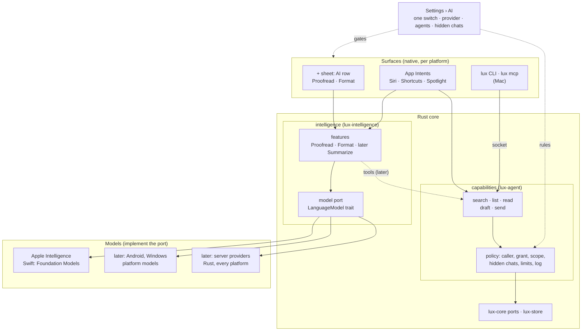
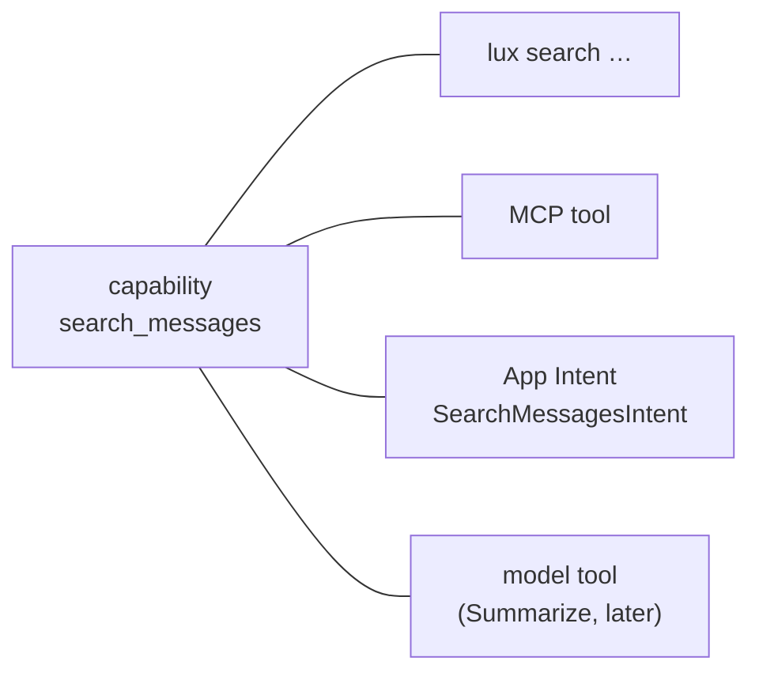

# AI in Lux: one architecture for writing help, Siri and agents

Status: proposal, nothing built. Written 2026-11-20, next to [mcp.md](mcp.md) (agents over MCP and
a CLI), which this page takes in as one of its parts.

**In one paragraph.** Lux gets AI in three places that share one design: **writing actions** in
the composer (first *Proofread* and *Format*, a row in the + sheet), **App Intents** (Siri,
Shortcuts, Spotlight, Apple Intelligence), and **agents** (MCP and the `lux` CLI). Under them, the
Rust core holds both shared layers, as it holds the rest of the app: **capabilities**, what can be
done with the account (search, read a chat, draft, send), and **intelligence**, the features
(their instructions, output schemas, validation, language rules) over a **model port**. Each
platform implements the port with its own model: Apple Intelligence through Foundation Models on
iPhone and Mac now, the platform's model elsewhere later, and a server provider in Rust that
works on every platform. Everything is off until the user turns on one switch in Settings › AI,
and the same switch turns it all off.

## Layers



- **Surfaces** only show and ask, natively (UIKit, AppKit, App Intents). None holds a rule.
- **Intelligence** is a crate of its own, `lux-intelligence`, beside `lux-core` (which it uses
  for Markdown and ids; `lux-core` stays without serde): what a feature asks, the shape of
  its answer, how the answer is checked, which languages a provider takes, the switch. It is
  tested with `cargo test` against a fake model, as the rest of the core is tested against the
  demo account.
- **The model port** is the only thing a platform implements. Apple's is a Swift class over
  Foundation Models, crossing as a UniFFI foreign trait, as the core's listeners already do
  (`#[uniffi::export(with_foreign)]`). This mirrors search, where the core keeps the index and
  Swift's model gives the embedding.
- **Capabilities** are `lux-agent` (mcp.md), the one place that decides who may see or do what.
  A caller is `user` (the app's own UI), `system` (an App Intent), `model` (a feature's tool
  call) or `agent(session)` (MCP and CLI). A feature that needs chats gets them through the
  capabilities, as tools, under the same policy as an agent.

## Intelligence

### The model port

```rust
// lux-intelligence/src/model.rs
pub trait LanguageModel: Send + Sync {
    fn availability(&self) -> Availability;              // ready, off in system settings, not on this device, downloading
    fn language_of(&self, text: &str) -> Option<String>; // the platform's detector (NaturalLanguage on Apple's)
    fn supports(&self, language: &str) -> bool;
    fn respond(&self, request: ModelRequest) -> impl Future<Output = Result<Value, ModelError>> + Send;
}

pub struct ModelRequest {
    pub instructions: String,
    pub prompt: String,
    pub output_schema: Value,  // from the output's type (schemars), every subschema inline
}
```

The port is JSON in, JSON out, because every model API speaks that way: Foundation Models builds
a schema at run time (`DynamicGenerationSchema` → `GenerationSchema`) and returns
`GeneratedContent`, which reads and writes JSON; server APIs take a JSON Schema for structured
output. Tools (a `ToolSpec` list and a tool-call answer, run by the core through the
capabilities) join the request when the first action needs them; the loop stays in Rust.

**Apple's adapter** (`Sources/LuxCore/Intelligence/AppleIntelligenceModel.swift`):
`SystemLanguageModel.default` for availability and `supportsLocale`, a `LanguageModelSession`
per request, the schema mapped to `DynamicGenerationSchema`, the answer's `GeneratedContent` back
to JSON. On iOS and macOS 27 the same adapter can take any Foundation Models `LanguageModel`
(Private Cloud Compute, src 3; or a custom `LanguageModelExecutor`, src 2), so more Apple-side
models need no new port. The adapter has no rules: no prompts, no checks.

**Other platforms**: an Android app would implement the port over the platform's on-device model,
a Windows app over its own; a server provider (Anthropic, OpenAI, a local server) is a Rust
implementation in a crate of its own (`lux-models`, with its HTTP client), so the intelligence
crate stays free of network code and every platform gets it at once.

### An action is data

Actions over the text will be many and alike, and the user will write their own. So an action is
not a type but a definition, and the code is shared by what the action gives back:

```rust
// lux-intelligence/src/action.rs
#[derive(Serialize, Deserialize)]
pub struct TextAction {
    pub id: String,            // proofread, format, or a user action's own
    pub name: String,
    pub instructions: String,  // a template
    pub prompt: String,        // a template
    pub output: Output,        // what the answer is, and how it applies
    pub context: ActionContext // how many of the chat's messages it may read
}

pub enum Output {
    Corrections,                                     // spans to replace, each taken or left
    Replacement { keep_links: bool, keep_code: bool }, // a new text, previewed before it applies
    Note,                                            // something to read, not applied
}
```

- **Templates** are Jinja (minijinja): `{{ text }}`, `{{ chat.name }}`, `{{ me.name }}`,
  `{{ language }}`, `{{ today }}`, `{{ m.sender }}: {{ m.text }}`.
  An action's variables are read from its templates (`undeclared_variables`); a name that is not
  a [`Variable`] is refused when the action is defined, not when it runs. Templates run with a
  fuel limit, so a user's loop cannot run away.
- **Context** comes from a `ContextSource` the app gives (the open chat), asked only for what the
  templates use: an action that never names `messages` never reads the chat. A hidden chat gives
  `Hidden`. When a prompt holds what others wrote (`chat`, `messages`), the instructions are told
  to follow nothing in it, by the crate, for every action.
- **Outputs** hold the shared code: each has its answer's schema and its checks.
  - *Corrections*: each correction is an exact span found in order; none may touch links, code
    or Markdown marks; ranges cross as UTF-16, as text views count. Proofread is this output.
  - *Replacement*: may change words; refused when empty, more than about twice as long, or (when
    kept) adding or dropping a link or code; gives a word diff (`similar`) for the preview, and
    applies as one undoable edit. Format is this output.
  - *Note*: shown, trimmed, never applied.
- **Built in**: `TextAction::proofread()` and `format()`, plain definitions. A user's action is the
  same JSON, kept later in account data so both devices have it. A new kind of result (insert at
  the cursor, a choice of replies) is one `Output` case with its schema and check.

[`Intelligence::run`] checks the text (availability, empty, length, language), fills the
variables, renders, asks the model for the output's schema, and checks the answer. The apps cross
only `CoreIntelligence.run(action, text, context)` and `built_in_text_actions()`, so the + sheet's
row is drawn from the list of actions, not from code per action.

**What stays native.** Apple's Writing Tools in the edit menu (`UITextView`/`NSTextView`, src 4)
stay, with `allowedWritingToolsResultOptions` set to plain text and lists mapped back to Markdown,
so they cannot leave rich text the composer does not send. Showing a correction's marks, the
preview and the progress are the UI's.

**The cost of Rust here**: Swift's `@Generable` macro and typed `Tool`s are not used; the schema
is the Rust type's, and the adapter maps it at run time. What it buys: one implementation and one
test suite for every platform and provider, rules beside the rest of the app's rules, and the
model calling capabilities without leaving the core.

### Libraries

What Rust's ecosystem gives, and what it does not (checked 2026-11-20):

| Need | Crate | Why |
|---|---|---|
| A schema from the output type | `schemars` (1.x) | The standard; `rmcp` uses it for MCP tool schemas too, so a capability's schema is one derive for MCP, the CLI's `lux schema` and the model's tools |
| Output as types | `serde`, `serde_json` | |
| Diff for Format's preview, ranges for Proofread | `similar` | Word and character diffs, the standard crate |
| Templates for prompts | `minijinja` | Jinja's syntax, safe to run (no I/O), fuel limits, lists the variables a template uses |
| The text's language | the platform, through the port | NaturalLanguage on Apple's systems; a Rust detector (`lingua`) adds tens of MB of models to the app |
| Markdown | `pulldown-cmark` | Already in `lux-core` |

**LLM frameworks: not now.** `rig-core` (MIT, 0.46, about 9k stars) is the most complete: typed
requests, tools by `#[rig_tool]`, a transport for in-process models. But it is before 1.0 and
rebuilt its provider layer within the last releases (weekly versions), and its structured output
is a synthetic tool call or a schema in the prompt, where Foundation Models constrains decoding to
the schema itself. `genai` (0.7) is a thin multi-provider client, HTTP only, with no hook for an
on-device model. Neither fits *under* the features without bending them. Both fit *behind* the
port: when server providers come, `lux-models` implements `LanguageModel` over `genai` or `rig`
and gets every provider they support, and nothing above the port changes. The port, the loop and
the features are a few hundred lines that Lux owns; the libraries do what is large (provider
APIs, auth, streaming). There is no official Anthropic Rust SDK; the crates by that name are
community ports.

For MCP the official `rmcp` stays the choice (mcp.md).

### Language

Apple Intelligence does not support Czech (src 5). For a Czech message the actions show as
unavailable with "Apple Intelligence doesn't support Czech yet", not as an error after the tap.
This is the first reason to add a second provider (Private Cloud Compute if its languages cover
it, or a server provider with the user's key), which this design takes without changes above the
port.

## The + sheet

The sheet from #139 (`AttachPanel`, `AttachChoice`) gets a second row under the attach buttons:

```
[ Camera ][ photo ][ photo ][ photo ] …
[ Photos ]  [ Files ]  [ Scan ]
✦ Proofread    ✦ Format                ← the AI row
```

- The row is the core's list of actions (`built_in_text_actions()`, later with the user's), each
  shown by its id's title and symbol for the built-in ones and by its name for a user's. Shown
  only when the switch is on and a model exists; enabled when `check_text` takes the composer's
  text.
- A new action needs no new UI: its `Output` decides how its result shows. On the Mac the same
  actions sit in the + menu and the composer's context menu.
- Tapping closes the sheet back to the keyboard and runs the action on the composer's text; the
  result shows in place (corrections marked in the text, a replacement's preview with Apply, a
  note).

## Settings › AI

One page, the same on both devices (the switch and the hidden chats sync in account data; the
provider and remembered agents are per device):

| Setting | Default | What it does |
|---|---|---|
| **AI features** | off | The one switch. Off: the AI row is gone, Lux's own actions disappear from Shortcuts and Siri, entities leave Spotlight's semantic index, the agents' socket closes. Nothing that uses a model or lets a model read runs |
| Provider | Apple Intelligence | Its state (ready, turned off in system settings, not on this device, downloading) and where text goes ("on this device") |
| Writing | Proofread, Format on | Which actions the + sheet shows |
| Siri and Shortcuts | on | Whether App Intents and entities are offered to the system |
| Agents (Mac) | off | MCP and the CLI ([mcp.md](mcp.md)): a new session's access (read only), remembered clients, sending limits, activity log |
| Hidden chats | none | Chats and networks no AI sees: not given to a model as a tool result, not to Siri or Spotlight (`hideInSpotlight`), not to an agent |

## App Intents

App Intents in the shared app code, calling the capabilities in-process (no socket) as the
`system` caller, and the features for the text ones:

| Intent / entity | What | Notes |
|---|---|---|
| `ConversationEntity`, `MessageEntity` (`IndexedEntity`), `ContactEntity` | Chats, messages, people for Siri, Shortcuts and Spotlight | On 27.3 the messages schemas: `@AppEntity(schema: .messages.message)` and the sample's entities (src 6) |
| `OpenChatIntent` | Opens a chat | Opens the app |
| `SearchMessagesIntent` | Search by words and meaning, returns messages | Read; hidden chats out |
| `SendMessageIntent` | `@AppIntent(schema: .messages.sendMessage)` on 27.3, a plain intent before | Always `requestConfirmation` with the exact text and chat: the system's confirmation is the canonical one |
| `ProofreadTextIntent`, `FormatTextIntent` | Text in, text out, for Shortcuts | Through the core's intelligence; unavailable when the switch is off |
| `.appEntityIdentifier(_:)` on the open chat | Onscreen context for Siri | |

On the iPhone an intent that reads the account opens the stores briefly when the app is not in
front, as the notification extension does, and closes them when it returns (`lifecycle.rs`);
this needs a spike, as iOS ends an app holding a lock in the App Group at suspension.

## How it fits the agents

The capabilities layer is mcp.md's `lux-agent` tool layer, named for what it is. The same
`search_messages` is a CLI command and an MCP tool for an agent, an App Intent for Siri, and
later a tool the model calls for a feature such as *Summarize this chat* or *What did I miss*,
handed to the model port as a `ToolSpec` and run by the core.
Each surface is a thin wrapper; the policy (caller, grant, scope, hidden chats, limits, log) is
applied once, in Rust, whoever calls. The writing features are not exposed to agents: an agent
has its own model.



## Where it lives

| Piece | Where | Size |
|---|---|---|
| Model port, `Intelligence`, actions as data, outputs with their checks, context variables; tests with a fake model | `core/crates/lux-intelligence` | M |
| UniFFI: the foreign `LanguageModel`, `CoreIntelligence` with typed results | `core/crates/lux-ffi/src/intelligence.rs` | S |
| Apple's adapter over Foundation Models (schema mapping, availability, languages) | `Sources/LuxCore/Intelligence/AppleIntelligenceModel.swift` | S–M |
| The AI row, Proofread's marks, Format's preview (iPhone); + menu and context menu (Mac) | `Apps/iOS/Features/Thread/`, `Apps/Mac/Features/Thread/` | M |
| Settings › AI (both) and the account-data keys for the switch and hidden chats | `Apps/*/Features/Settings/`, `lux-matrix/src/organizer/` | S–M |
| Capabilities with policy (`lux-agent`), shared with mcp.md | `core/crates/lux-agent` | M |
| App Intents and entities | `Apps/Shared/Intents/` | M |
| Agents: `lux` CLI, `lux mcp`, socket, session dialog | mcp.md | M |
| Later: server providers, over `genai` or `rig` behind the port | `core/crates/lux-models` | M |

Order: intelligence and the two actions with Settings › AI first (they need no capabilities and
ship on their own); then capabilities with App Intents; then agents on the Mac.

## Open decisions

1. Does the one switch also hide plain Shortcuts actions that use no model (Open Chat, Search)?
   Proposed: yes, one switch means everything; the system's intents for Lux simply vanish.
2. Proofread's result as marks in the text (proposed) or a preview sheet with the corrected text?
3. When a second provider comes for Czech: Private Cloud Compute (needs Apple's entitlement and
   its languages), or a server provider with the user's own key?

## Sources

1. Foundation Models — https://developer.apple.com/documentation/foundationmodels (SystemLanguageModel,
   LanguageModelSession, Generable, Tool; iOS/macOS 26)
2. `LanguageModel` and `LanguageModelExecutor` (custom providers, 27.0) — https://developer.apple.com/documentation/foundationmodels/languagemodel ,
   https://developer.apple.com/documentation/foundationmodels/languagemodelexecutor
3. `PrivateCloudComputeLanguageModel` (27.0, entitlement) — https://developer.apple.com/documentation/foundationmodels/privatecloudcomputelanguagemodel
4. Writing Tools, `UIWritingToolsResultOptions` (list, table) — https://developer.apple.com/documentation/uikit/writing-tools ,
   https://developer.apple.com/documentation/uikit/uiwritingtoolsresultoptions
5. Apple Intelligence languages (no Czech) — https://www.apple.com/apple-intelligence/ ; supported languages
   per model: `SystemLanguageModel.supportedLanguages`, https://developer.apple.com/documentation/foundationmodels/supporting-languages-and-locales-with-foundation-models
6. Integrating your messaging app with Apple Intelligence (27.3 beta) — https://developer.apple.com/documentation/appintents/integrating-your-messaging-app-with-apple-intelligence ;
   `IndexedEntity` https://developer.apple.com/documentation/appintents/indexedentity ;
   `requestConfirmation` https://developer.apple.com/documentation/appintents/appintent

7. Rust crates (2026-11-20) — rig-core https://docs.rs/crate/rig-core/latest , https://github.com/0xPlaygrounds/rig ;
   genai https://docs.rs/crate/genai/latest ; schemars https://docs.rs/schemars ;
   similar https://docs.rs/similar ; minijinja https://docs.rs/minijinja ; lingua https://docs.rs/lingua ; rmcp https://github.com/modelcontextprotocol/rust-sdk

Not verified: that a JSON Schema subset maps cleanly to `DynamicGenerationSchema` and
`GeneratedContent` reads back as JSON (a spike before the port is fixed); whether tools work
through a custom `LanguageModelExecutor` (the executor receives the transcript and must map it); Private Cloud Compute's languages and
context size; the messages domain's full schema list.
