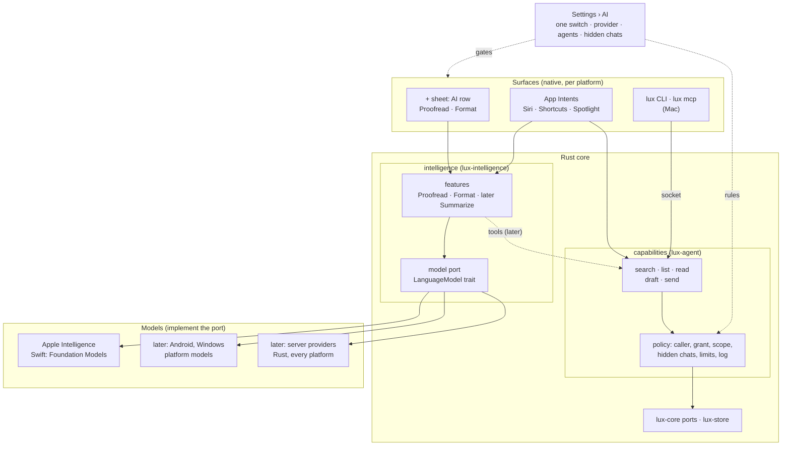
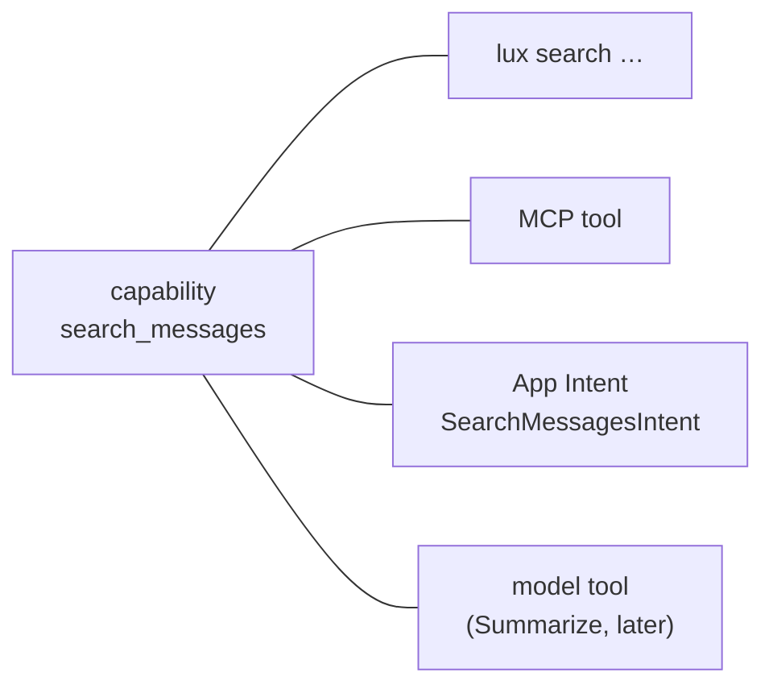

# AI in Lux: one architecture for writing help, Siri and agents

Status: proposal, nothing built. Written 2026-11-20, next to [mcp.md](mcp.md) (agents over MCP and
a CLI), which this page takes in as one of its parts.

**In one paragraph.** Lux gets AI in three places that share one design: **writing actions** in
the composer (first *Proofread* and *Format*, a row in the + sheet), **App Intents** (Siri,
Shortcuts, Spotlight, Apple Intelligence), and **agents** (MCP and the `lux` CLI). Under them, the
Rust core holds both shared layers, as it holds the rest of the app: **capabilities**, what can be
done with the account (search, read a chat, draft, send), and **intelligence**, the features
(their instructions, output schemas, validation, language rules) over a **model port**. Each
platform implements the port with its own model: Apple Intelligence through Foundation Models on
iPhone and Mac now, the platform's model elsewhere later, and a server provider in Rust that
works on every platform. Everything is off until the user turns on one switch in Settings › AI,
and the same switch turns it all off.

## Layers



- **Surfaces** only show and ask, natively (UIKit, AppKit, App Intents). None holds a rule.
- **Intelligence** is a crate of its own, `lux-intelligence`, beside `lux-core` (which it uses
  for Markdown and ids; `lux-core` stays without serde): what a feature asks, the shape of
  its answer, how the answer is checked, which languages a provider takes, the switch. It is
  tested with `cargo test` against a fake model, as the rest of the core is tested against the
  demo account.
- **The model port** is the only thing a platform implements. Apple's is a Swift class over
  Foundation Models, crossing as a UniFFI foreign trait, as the core's listeners already do
  (`#[uniffi::export(with_foreign)]`). This mirrors search, where the core keeps the index and
  Swift's model gives the embedding.
- **Capabilities** are `lux-agent` (mcp.md), the one place that decides who may see or do what.
  A caller is `user` (the app's own UI), `system` (an App Intent), `model` (a feature's tool
  call) or `agent(session)` (MCP and CLI). A feature that needs chats gets them through the
  capabilities, as tools, under the same policy as an agent.

## Intelligence

### The model port

```rust
// lux-intelligence/src/model.rs
pub trait LanguageModel: Send + Sync {
    fn id(&self) -> ModelId;                          // apple-intelligence; later private-cloud, anthropic, …
    fn availability(&self) -> ModelAvailability;      // ready, off in system settings, not on this device, downloading
    fn supports(&self, language: &LanguageTag) -> bool;
    fn data_location(&self) -> DataLocation;          // on this device, Apple's servers, a provider
    /// One turn: instructions, the prompt, an output JSON Schema, tools it may call.
    fn respond(&self, request: ModelRequest) -> impl Future<Output = Result<ModelResponse, ModelError>> + Send;
}

pub struct ModelRequest {
    pub instructions: String,
    pub prompt: String,
    pub output_schema: JsonSchema,                    // a small subset: object, array, string, enum, number
    pub tools: Vec<ToolSpec>,                         // name, description, input schema; empty for Proofread and Format
}
pub enum ModelResponse { Output(serde_json::Value), ToolCall { name: String, arguments: serde_json::Value } }
```

The port is JSON in, JSON out, because every model API speaks that way: Foundation Models builds
a schema at run time (`DynamicGenerationSchema` → `GenerationSchema`) and returns
`GeneratedContent`, which reads and writes JSON; server APIs take a JSON Schema for structured
output and tool calls. A tool call returns to the core, which runs it through the capabilities
and policy and calls `respond` again with the result: the loop and its rules stay in Rust.

**Apple's adapter** (`Sources/LuxCore/Intelligence/AppleIntelligenceModel.swift`):
`SystemLanguageModel.default` for availability and `supportsLocale`, a `LanguageModelSession`
per request, the schema mapped to `DynamicGenerationSchema`, the answer's `GeneratedContent` back
to JSON. On iOS and macOS 27 the same adapter can take any Foundation Models `LanguageModel`
(Private Cloud Compute, src 3; or a custom `LanguageModelExecutor`, src 2), so more Apple-side
models need no new port. The adapter has no rules: no prompts, no checks.

**Other platforms**: an Android app would implement the port over the platform's on-device model,
a Windows app over its own; a server provider (Anthropic, OpenAI, a local server) is a Rust
implementation in a crate of its own (`lux-models`, with its HTTP client), so the intelligence
crate stays free of network code and every platform gets it at once.

### A feature is a type, in Rust

```rust
// lux-intelligence/src/feature.rs
pub trait Feature {
    type Input;
    type Output: DeserializeOwned + JsonSchema;        // schemars derives the schema from the type
    const ID: FeatureId;
    fn instructions(&self) -> &'static str;
    fn prompt(&self, input: &Self::Input) -> String;
    /// What the model gave, checked: never trusted as it came.
    fn validate(&self, output: Self::Output, input: &Self::Input) -> Result<Self::Output, FeatureError>;
}

pub struct Intelligence<M: LanguageModel> { /* the switch, the chosen model, the hidden chats */ }
impl<M: LanguageModel> Intelligence<M> {
    pub async fn perform<F: Feature>(&self, feature: &F, input: F::Input) -> Result<F::Output, FeatureError>;
}
```

`perform` checks the switch, the model's availability and the input's language (`lingua`, below), builds the request from the feature, asks the model,
deserializes and validates, and records a `tracing` span (the app wraps the call in `Signposts`). The app crosses only
`CoreIntelligence.proofread(text)` / `format(text)` and their typed results.

**Proofread.** Output `Proofreading { corrections: [Correction] }`, each `{ original, replacement,
kind: spelling | grammar | punctuation }` with `original` an exact span of the text. Validation
keeps only corrections whose `original` is found in order, and drops any that touch Markdown
marks, links, mentions or code (`lux-core/src/markdown.rs` already knows them). The result
crosses as ranges and replacements; the composer shows them marked in the text (the same styling
pass that dims Markdown marks), with Apply all, and each one tappable to apply or dismiss. The
message is never rewritten as a whole.

**Format.** Output `Formatted { markdown: String }`: the message laid out with lists, bold,
quotes and paragraphs the composer's Markdown knows. It may change words where the layout asks for
it (a sentence turned into list items, a joining word dropped). So it is never applied unseen: the
composer shows a preview with the changes marked (a word diff, `similar`), and Apply replaces the
text as one undoable edit. Validation (with `pulldown-cmark`, which reads the composer's Markdown
already) refuses an answer that is empty, more than about twice as long, adds a link, a mention or
code the text did not have, or drops one it had, so a reformatted message cannot gain a URL or
address someone new.

Both are small prompts on short text, so the on-device model fits well. Streaming into the
preview can come later as a second port method (`respond_stream`, partial JSON).

**What stays native.** Apple's Writing Tools in the edit menu (`UITextView`/`NSTextView`, src 4)
stay, with `allowedWritingToolsResultOptions` set to plain text and lists mapped back to Markdown,
so they cannot leave rich text the composer does not send. Showing a correction's marks, the
preview and the progress are the UI's.

**The cost of Rust here**: Swift's `@Generable` macro and typed `Tool`s are not used; the schema
is the Rust type's, and the adapter maps it at run time. What it buys: one implementation and one
test suite for every platform and provider, rules beside the rest of the app's rules, and the
model calling capabilities without leaving the core.

### Libraries

What Rust's ecosystem gives, and what it does not (checked 2026-11-20):

| Need | Crate | Why |
|---|---|---|
| A schema from the output type | `schemars` (1.x) | The standard; `rmcp` uses it for MCP tool schemas too, so a capability's schema is one derive for MCP, the CLI's `lux schema` and the model's tools |
| Output as types | `serde`, `serde_json` | |
| Checking the answer against the schema before deserializing | `jsonschema` | A model that ignores the schema gets a typed error, not a panic |
| Diff for Format's preview, ranges for Proofread | `similar` | Word and character diffs, the standard crate |
| The text's language | `lingua` | Accurate on short text, has Czech; built with only the languages Lux needs, since each adds its model's size |
| Markdown | `pulldown-cmark` | Already in `lux-core` |

**LLM frameworks: not now.** `rig-core` (MIT, 0.46, about 9k stars) is the most complete: typed
requests, tools by `#[rig_tool]`, a transport for in-process models. But it is before 1.0 and
rebuilt its provider layer within the last releases (weekly versions), and its structured output
is a synthetic tool call or a schema in the prompt, where Foundation Models constrains decoding to
the schema itself. `genai` (0.7) is a thin multi-provider client, HTTP only, with no hook for an
on-device model. Neither fits *under* the features without bending them. Both fit *behind* the
port: when server providers come, `lux-models` implements `LanguageModel` over `genai` or `rig`
and gets every provider they support, and nothing above the port changes. The port, the loop and
the features are a few hundred lines that Lux owns; the libraries do what is large (provider
APIs, auth, streaming). There is no official Anthropic Rust SDK; the crates by that name are
community ports.

For MCP the official `rmcp` stays the choice (mcp.md).

### Language

Apple Intelligence does not support Czech (src 5). For a Czech message the actions show as
unavailable with "Apple Intelligence doesn't support Czech yet", not as an error after the tap.
This is the first reason to add a second provider (Private Cloud Compute if its languages cover
it, or a server provider with the user's key), which this design takes without changes above the
port.

## The + sheet

The sheet from #139 (`AttachPanel`, `AttachChoice`) gets a second row under the attach buttons:

```
[ Camera ][ photo ][ photo ][ photo ] …
[ Photos ]  [ Files ]  [ Scan ]
✦ Proofread    ✦ Format                ← the AI row
```

- An `enum ComposerAction: CaseIterable { case proofread, format }` beside `AttachChoice`, with
  title, symbol and `isAvailable(text:intelligence:)`: shown only when the switch is on and a
  provider exists; enabled when the composer has text in a language the provider supports.
- The row is a list of the features the composer offers, so a third action is one case and one
  feature type. On the Mac the same actions sit in the + menu and the composer's context menu.
- Tapping closes the sheet back to the keyboard and runs the feature on the composer's text; the
  result shows in place (Proofread's marks, Format's preview with Apply).

## Settings › AI

One page, the same on both devices (the switch and the hidden chats sync in account data; the
provider and remembered agents are per device):

| Setting | Default | What it does |
|---|---|---|
| **AI features** | off | The one switch. Off: the AI row is gone, Lux's own actions disappear from Shortcuts and Siri, entities leave Spotlight's semantic index, the agents' socket closes. Nothing that uses a model or lets a model read runs |
| Provider | Apple Intelligence | Its state (ready, turned off in system settings, not on this device, downloading) and where text goes ("on this device") |
| Writing | Proofread, Format on | Which actions the + sheet shows |
| Siri and Shortcuts | on | Whether App Intents and entities are offered to the system |
| Agents (Mac) | off | MCP and the CLI ([mcp.md](mcp.md)): a new session's access (read only), remembered clients, sending limits, activity log |
| Hidden chats | none | Chats and networks no AI sees: not given to a model as a tool result, not to Siri or Spotlight (`hideInSpotlight`), not to an agent |

## App Intents

App Intents in the shared app code, calling the capabilities in-process (no socket) as the
`system` caller, and the features for the text ones:

| Intent / entity | What | Notes |
|---|---|---|
| `ConversationEntity`, `MessageEntity` (`IndexedEntity`), `ContactEntity` | Chats, messages, people for Siri, Shortcuts and Spotlight | On 27.3 the messages schemas: `@AppEntity(schema: .messages.message)` and the sample's entities (src 6) |
| `OpenChatIntent` | Opens a chat | Opens the app |
| `SearchMessagesIntent` | Search by words and meaning, returns messages | Read; hidden chats out |
| `SendMessageIntent` | `@AppIntent(schema: .messages.sendMessage)` on 27.3, a plain intent before | Always `requestConfirmation` with the exact text and chat: the system's confirmation is the canonical one |
| `ProofreadTextIntent`, `FormatTextIntent` | Text in, text out, for Shortcuts | Through the core's intelligence; unavailable when the switch is off |
| `.appEntityIdentifier(_:)` on the open chat | Onscreen context for Siri | |

On the iPhone an intent that reads the account opens the stores briefly when the app is not in
front, as the notification extension does, and closes them when it returns (`lifecycle.rs`);
this needs a spike, as iOS ends an app holding a lock in the App Group at suspension.

## How it fits the agents

The capabilities layer is mcp.md's `lux-agent` tool layer, named for what it is. The same
`search_messages` is a CLI command and an MCP tool for an agent, an App Intent for Siri, and
later a tool the model calls for a feature such as *Summarize this chat* or *What did I miss*,
handed to the model port as a `ToolSpec` and run by the core.
Each surface is a thin wrapper; the policy (caller, grant, scope, hidden chats, limits, log) is
applied once, in Rust, whoever calls. The writing features are not exposed to agents: an agent
has its own model.



## Where it lives

| Piece | Where | Size |
|---|---|---|
| Model port, `Intelligence`, `Feature`; Proofread and Format with validation; tests with a fake model | `core/crates/lux-intelligence` | M |
| UniFFI: the foreign `LanguageModel`, `CoreIntelligence` with typed results | `core/crates/lux-ffi/src/intelligence.rs` | S |
| Apple's adapter over Foundation Models (schema mapping, availability, languages) | `Sources/LuxCore/Intelligence/AppleIntelligenceModel.swift` | S–M |
| The AI row, Proofread's marks, Format's preview (iPhone); + menu and context menu (Mac) | `Apps/iOS/Features/Thread/`, `Apps/Mac/Features/Thread/` | M |
| Settings › AI (both) and the account-data keys for the switch and hidden chats | `Apps/*/Features/Settings/`, `lux-matrix/src/organizer/` | S–M |
| Capabilities with policy (`lux-agent`), shared with mcp.md | `core/crates/lux-agent` | M |
| App Intents and entities | `Apps/Shared/Intents/` | M |
| Agents: `lux` CLI, `lux mcp`, socket, session dialog | mcp.md | M |
| Later: server providers, over `genai` or `rig` behind the port | `core/crates/lux-models` | M |

Order: intelligence and the two actions with Settings › AI first (they need no capabilities and
ship on their own); then capabilities with App Intents; then agents on the Mac.

## Open decisions

1. Does the one switch also hide plain Shortcuts actions that use no model (Open Chat, Search)?
   Proposed: yes, one switch means everything; the system's intents for Lux simply vanish.
2. Proofread's result as marks in the text (proposed) or a preview sheet with the corrected text?
3. When a second provider comes for Czech: Private Cloud Compute (needs Apple's entitlement and
   its languages), or a server provider with the user's own key?

## Sources

1. Foundation Models — https://developer.apple.com/documentation/foundationmodels (SystemLanguageModel,
   LanguageModelSession, Generable, Tool; iOS/macOS 26)
2. `LanguageModel` and `LanguageModelExecutor` (custom providers, 27.0) — https://developer.apple.com/documentation/foundationmodels/languagemodel ,
   https://developer.apple.com/documentation/foundationmodels/languagemodelexecutor
3. `PrivateCloudComputeLanguageModel` (27.0, entitlement) — https://developer.apple.com/documentation/foundationmodels/privatecloudcomputelanguagemodel
4. Writing Tools, `UIWritingToolsResultOptions` (list, table) — https://developer.apple.com/documentation/uikit/writing-tools ,
   https://developer.apple.com/documentation/uikit/uiwritingtoolsresultoptions
5. Apple Intelligence languages (no Czech) — https://www.apple.com/apple-intelligence/ ; supported languages
   per model: `SystemLanguageModel.supportedLanguages`, https://developer.apple.com/documentation/foundationmodels/supporting-languages-and-locales-with-foundation-models
6. Integrating your messaging app with Apple Intelligence (27.3 beta) — https://developer.apple.com/documentation/appintents/integrating-your-messaging-app-with-apple-intelligence ;
   `IndexedEntity` https://developer.apple.com/documentation/appintents/indexedentity ;
   `requestConfirmation` https://developer.apple.com/documentation/appintents/appintent

7. Rust crates (2026-11-20) — rig-core https://docs.rs/crate/rig-core/latest , https://github.com/0xPlaygrounds/rig ;
   genai https://docs.rs/crate/genai/latest ; schemars https://docs.rs/schemars ; jsonschema https://docs.rs/jsonschema ;
   similar https://docs.rs/similar ; lingua https://docs.rs/lingua ; rmcp https://github.com/modelcontextprotocol/rust-sdk

Not verified: that a JSON Schema subset maps cleanly to `DynamicGenerationSchema` and
`GeneratedContent` reads back as JSON (a spike before the port is fixed); whether tools work
through a custom `LanguageModelExecutor` (the executor receives the transcript and must map it); Private Cloud Compute's languages and
context size; the messages domain's full schema list.
