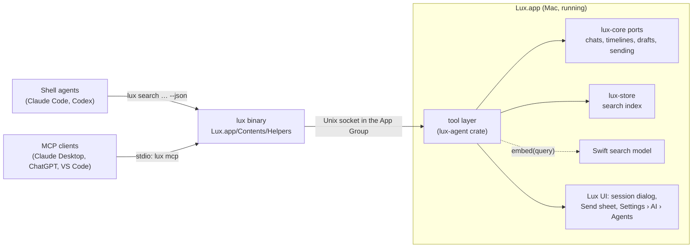

# Agents in Lux: MCP and a CLI, a proposal

Status: proposal, nothing built. Researched 2026-11-20. Part of [ai.md](ai.md), which joins this
with writing actions and App Intents; the tool layer here is its capabilities layer. Sources are listed at the end; "(src N)"
points to them.

**In one paragraph.** Lux's messages are readable only on a signed-in device: decrypted in the
SDK's stores and in the SQLCipher search index (`lux-store`), with the search model in the app.
So an agent interface for Lux has to run **on the Mac, inside the running app**. The first
version is one tool layer in the Mac app with two fronts in one bundled `lux` binary: **a CLI**
(`lux search …`, for Claude Code, Codex and scripts, with an agent skill) and **an MCP server**
(`lux mcp`, stdio, packaged as an `.mcpb` for Claude Desktop and other chat apps). Both reach the
app over a Unix socket in the App Group container. Each new session is approved in a **Lux
dialog with a match code**, where the user also chooses read only or read and drafts. An agent
can search (by words and by meaning), list chats and unreads, read a thread, and write a *draft*
into a chat's composer. Sending is a button in Lux that the user presses, never a tool. iPhone
gets App Intents, not MCP. A remote server on the homeserver is rejected: it could not read
encrypted chats without becoming a device that holds the keys.

## Built (first version, 2026-11-20)

What the code does now, where it differs from the proposal below:

- **One binary, no helper.** The `lux` binary is the app's own executable run as
  `Lux.app/Contents/MacOS/Lux agent <command>` (`agent mcp` for MCP). The same app has the same
  sandbox container, so the socket sits in the container's `tmp` (`agents.sock`): no App Group,
  no provisioning profile for a helper, no second signed target (risk 1 below is gone).
- **`lux-agent` crate**: the tools (`list_chats`, `search_messages`, `read_chat`, `draft_reply`,
  `send_message`, and `request_access` over MCP), their JSON Schemas (schemars), grants
  (read < drafts < send), the hidden chats, 60 calls a minute, plain capped text, the log; the
  socket's server and its CLI and MCP (`rmcp` 3.11, 2026-07-28 with fallback) clients. Tested over
  a real socket with a fake account and approver.
- **Reading** comes from the encrypted index on the Mac (`Store::recent`, `Store::search` with the
  meaning's embedding from the app): no timeline is opened, nothing is asked of the server.
- **Sessions**: an MCP connection is a session; a CLI command (one per process) reuses an
  approval for 30 minutes per client and folder. The dialog shows the client's name as it says,
  its command and folder, and the match code the client prints on stderr; access defaults to read
  only; "Always allow" remembers the client. More access is asked with `request_access`, shown
  again with the agent's reason; three refusals end the session.
- **Drafts and sending**: a draft opens the chat with the text in its composer. Sending, by the
  session's grant:
  - *ask to send*: in a client that draws MCP Apps (`io.modelcontextprotocol/ui` in its
    capabilities), `send_message` shows a preview (`ui://lux/send.html`) with Send; its token is
    in the result's `_meta`, and Send calls `confirm_send`, an app-only tool
    (`_meta.ui.visibility: ["app"]`) the host never lists to the model. Checked on Claude Code
    2.1.310: the app-only tool is not offered to the model, and `_meta` does not reach it, while
    `structuredContent` does (so the token is never there). Elsewhere (the CLI, a client without
    MCP Apps), Lux asks Send / Cancel;
  - *send on its own*: only in a chat the session read (`read_chat`), at most 10 an hour; any
    other message is asked as above.
  - either way Lux sends the text alone, from the core (`send_now`, back once the server has
    it): nothing of the composer's (its files, a reply or an edit) goes with it; a draft and a
    send report whether they happened.
- **Limits on what a client sends**: lines over 256 KiB end the connection; texts, search words
  and reasons are capped; a client that leaves while Lux asks ends its approval.
- **Settings › Agents** (Mac): the switch (under AI), the commands to copy (`claude mcp add …`),
  Install Skill… (a short `SKILL.md`: what Lux is and how its permissions work, written to the
  skills folder the user picks, as the sandbox requires), **Add to Claude Desktop…** (an `.mcpb`
  made on the spot, its server this app's own executable, opened with Claude Desktop), the chats
  hidden from every AI, the clients always allowed, and the latest calls.
- **Hidden chats** are account data (`com.bardav.lux.ai`, `{"hidden": [{"chat", "name"}]}`) in the
  organizer, so every device has them; the agent reads them from the account on each call, and
  Siri's search leaves them out.
- **Not yet**: the log kept in the encrypted store (it is in memory), localhost HTTP.

## 1. The standard today

### Spec revisions

| Revision | What matters for Lux |
|---|---|
| 2025-03-26 | Streamable HTTP replaces HTTP+SSE; tool annotations (`readOnlyHint`, `destructiveHint`, `idempotentHint`, `openWorldHint`) |
| 2025-06-18 | Structured tool output (`outputSchema`, `structuredContent`), resource links in tool results, elicitation (form) |
| 2025-11-25 | URL-mode elicitation, experimental tasks, Client ID Metadata Documents (CIMD) |
| **2026-07-28 (current)** | Stateless core (src 1–3) |

What the current revision changed (src 1):

- **No handshake, no sessions.** `initialize` is gone; every request carries the protocol version
  and client capabilities in `_meta`. `server/discover` (required) tells a client what a server
  has. `Mcp-Session-Id` is gone: state that spans calls is a handle the server mints and the
  client passes back as an argument; possessing one is not authentication (src 3).
- **Streamable HTTP**: `subscriptions/listen` replaces the GET stream and `resources/subscribe`;
  no SSE resumption; POSTs carry `Mcp-Method` and `Mcp-Name` headers. stdio is unchanged.
- **Multi round-trip requests (MRTR)**: a server that needs input (elicitation) returns
  `resultType: "input_required"` and the client retries with `inputResponses`, so no open
  bidirectional stream is needed.
- **Tasks** moved to an official extension (`io.modelcontextprotocol/tasks`), next to extensions
  such as MCP Apps (interactive UI in the client).
- **Deprecated** (12-month window): **Roots, Sampling, Logging**, the HTTP+SSE transport, and
  Dynamic Client Registration. A server that wants a model calls one itself; a server that
  wants a scope takes it as a tool parameter or resource URI.
- **Schemas**: `inputSchema`/`outputSchema` may use any JSON Schema 2020-12 keyword;
  `structuredContent` may be any JSON value.

Clients lag: most shipped clients speak 2025-06-18 or 2025-11-25. An SDK that negotiates both
(stdio falls back on a `server/discover` probe) is the practical target.

### Authorization (src 2)

Optional, and for HTTP only. **stdio servers should not use it and take credentials from their
environment.** For HTTP: OAuth 2.1 with PKCE; the server publishes Protected Resource Metadata
(RFC 9728) pointing at its authorization server (RFC 8414/OIDC discovery); clients register by
**Client ID Metadata Documents** (preferred), pre-registration, or Dynamic Client Registration
(deprecated); clients send `resource` (RFC 8707) and the server checks the token's audience;
no token passthrough; insufficient scope is a 403 with `error="insufficient_scope"` and step-up.

### Security guidance (src 3, 13–15)

The spec's best practices: confused deputy (a proxy must get per-client consent), no token
passthrough, SSRF, state-handle hijacking, **local server compromise** (prefer stdio; for HTTP
require a token or use Unix sockets or other restricted IPC; DNS rebinding against an open
localhost port), scope minimization.

For a messenger the governing risk is the **lethal trifecta** (src 14): private data +
untrusted content + a way to send data out. A chat client has all three in one server: the
messages are private, every message is text written by someone else, and sending is an
exfiltration channel. Invariant Labs showed it on the community WhatsApp MCP server: one
message sent to the victim made the agent leak their contacts (src 13). Tool poisoning (a
server's tool descriptions instructing the model) and rug pulls apply to the *other* servers in
the same client; Lux cannot fix those, only refuse to be the outlet. The conclusions Lux draws:

1. A message's text is data. Results mark it as quoted content from a named sender, never as
   instructions, and a description says so. That helps the model; it is not a boundary.
2. **The boundary is the user, in Lux's own UI.** What an agent may do is granted in a Lux
   dialog, not in the client: a client's approval prompt is drawn by the client, whose model is
   the party being tricked. A message leaves only on the user's click, or under a sending grant
   the user gave in Lux, within rules that keep the outlet narrow.
3. Least privilege per client: read only by default, scoped to chosen networks or chats.

### Distribution

- **MCP Bundles (`.mcpb`, formerly DXT)** (src 4): a zip with `manifest.json` and a server;
  server type `binary` is allowed (no runtime needed); `user_config` fields can be `sensitive`
  (masked, stored securely by the host); `compatibility.platforms: ["darwin"]`. Claude Desktop
  installs it by double-click.
- **MCP Registry** (src 5): preview since 2025-09, API frozen at v0.1; a `server.json` names
  packages (npm, PyPI, OCI, MCPB) or remotes; namespaces are verified by GitHub or DNS
  (`com.bardav/lux` via DNS). Optional for Lux; a bundle linked from the site is enough.

## 2. How others do it

| Product | Form | Auth | Writes | Why this form |
|---|---|---|---|---|
| **Beeper Desktop** (src 6, 17) | Local server in the desktop app, Streamable HTTP `localhost:23373/v0/mcp`; stdio shim `@beeper/mcp-remote` (Node); **and an official CLI** (`beeper`, Homebrew/npm) on the same local API, with `--read-only`; community CLIs ship agent skills | Bearer token per approved connection, or OAuth 2.0 + PKCE served by the app; read/write access | Send, edit, delete, react, start chat, archive, reminders, upload | Chats decrypted only on the device; desktop only; remote access off by default with an explicit warning |
| **Slack** (src 7) | Remote, `mcp.slack.com/mcp` | Confidential OAuth, user-token scopes per tool; no DCR | By scope (`chat:write`) | Server-side data; admin approval and audit logs |
| **Notion** (src 8) | Remote, `mcp.notion.com/mcp` | OAuth; workspace MCP tokens on business plans | Yes | Server-side data |
| **Linear** (src 9) | Remote, `mcp.linear.app/mcp`, and `/mcp/readonly` | OAuth 2.1 + DCR, or API key | Not on `/readonly` | A whole read-only endpoint is the simplest least privilege |
| **GitHub** (src 10) | Remote and local (stdio binary) | OAuth or PAT | Toolsets; `--read-only` beats everything | Lockdown mode filters untrusted public content, documented as "not an authorization boundary" |
| Matrix community servers (src 11) | Local stdio, an access token | Token in env | Most send | None decrypts E2E rooms; they read unencrypted rooms only |
| WhatsApp/Telegram community | Local, unofficial clients | Session files | Send | The WhatsApp one is the trifecta case study (src 13) |
| Discord, Telegram, WhatsApp (official) | None found | | | |
| **Apple** (src 12, 16) | No public MCP API. macOS 26.1 beta carried MCP code for App Intents (press, 2025-09); WWDC 2026 reports describe App Intents as the way Siri and agents act in apps; nothing documented as MCP. `intents-mcp` (community) exposes Shortcuts/App Intents as MCP tools | | | App Intents is Apple's agent surface |

The pattern: **data on a server → remote server with OAuth; data only on a device → local server
in the app (Beeper).** Read-only is offered as a separate token or endpoint (Linear, GitHub).
Every vendor that allows sending leaves confirmation to the client's prompt. Lux can do better
because it owns a UI.

## 3. Forms for Lux

Facts that decide (from the code):

- Decrypted messages exist only in the SDK's stores and the index under `matrix/<store>/`, keys
  in the Keychain (architecture.md, "On the device"). On the Mac the folder is in Application
  Support of the sandbox container; the App Group is shared with the asset downloader.
- Search by meaning needs the query's embedding from the search model, which runs in Swift
  (`MessageMeaning`, `PhotoSearchModel`); `lux-store`'s `TextSearch` takes it as an input.
- The Mac app is sandboxed with `network.client` only; listening on a port needs
  `com.apple.security.network.server`.
- On iPhone the app is suspended in the background and the stores close (`lifecycle.rs`). No
  server can stay up there.

| Form | Reads E2E content | Sandbox / App Store | Effort | Verdict |
|---|---|---|---|---|
| **(a1) In-app server, stdio helper + Unix socket in the App Group** | Yes, through the running app | No new entitlement; the helper needs the App Group (see risks) | M | **First** |
| (a2) In-app server, localhost Streamable HTTP (Beeper's way) | Yes | Needs `network.server`; must check `Origin`/`Host` against DNS rebinding, a bearer token, OAuth to be convenient | M–L | Later, for clients without stdio |
| **(b) `.mcpb` around (a1)** | – | The bundle's `binary` server is a tiny launcher of the helper inside Lux.app | S | **First**, with (a1) |
| **(a3) A CLI instead of (or beside) MCP**: the same helper with subcommands, JSON out | Yes, through the running app | Same as (a1) | S on top of the tool layer | **First, beside (a1)**: see below |
| (c) Remote server on the homeserver or the bot | No: only by being a device with every room's keys on a server, which undoes E2E. The bot sees only rooms it is in | – | L | **No** |
| **(d) App Intents** (Shortcuts, Siri, Spotlight) | Yes, in the app | Native on both | M | **Second**: the only way on iPhone, and on the Mac it reaches agents through Shortcuts and Apple's own direction |
| A second process opening the stores itself | Yes | Two processes on SQLCipher and the crypto store; the model loaded twice; races with sync | L | No |

Why (a1) over (a2) first: the spec's own advice for local servers is stdio or restricted IPC
(src 3); a socket file in a container directory only processes with the App Group can open is
closed to the rest of the machine and to web pages (no DNS rebinding, no port to guess), needs
no new entitlement, and every main client (Claude Desktop and Code, Codex, Cursor, VS Code)
speaks stdio. (a2) is the same server with another transport; adding it later costs little if
the server is transport-neutral.

What the agent gets when Lux is closed: an error that says "Open Lux". Beeper does the same.

### MCP or a CLI?

A CLI (`lux chats --unread --json`, `lux search "faktura" --meaning`, `lux read <chat> --limit 50`,
`lux draft <chat> "…"`) is what coding agents use best in 2026: Claude Code, Codex and Copilot
CLI run shell commands natively, a command costs a few hundred tokens where an MCP server's
tool schemas sit in the context all the time (measured at several times to tens of times more;
tool search narrows the gap), and output pipes into `jq`, scripts and Shortcuts' "Run Shell
Script" (src 18–20). An agent skill (`SKILL.md`: what the commands are, that message text is
data, that sending is the user's) teaches it with no context cost until used. Beeper ships both,
a CLI and MCP, over the same local API (src 17).

What a CLI cannot do: reach agents without a shell. Claude Desktop's chat, ChatGPT and other chat
apps connect only to MCP servers. And it has no session: each command is a new process, so
approval has to be held for the calling process tree for a while (below), not for a connection.

| | CLI | MCP |
|---|---|---|
| Clients | Shell agents (Claude Code, Codex), scripts, Shortcuts | Every MCP client, incl. chat apps without a shell |
| Context cost | Low; a skill loads on demand | Tool schemas always loaded (less with tool search) |
| Composition | Pipes, files, `jq`, loops in one command | One call at a time through the model |
| Typed results, annotations | JSON by convention; `lux schema` prints it | `outputSchema`, `readOnlyHint` the client understands |
| Session for approval | Per calling process tree, time-limited | Per connection (the helper's lifetime) |
| Testing by hand | Trivial | Needs an inspector |

**Both, from one binary.** The tools are one layer in the app (`lux-agent` crate): names,
arguments, JSON results, scopes, limits, the log. `lux <command>` and `lux mcp` are two thin
fronts over the same socket, so a CLI command and an MCP tool are the same call and cannot
drift. The CLI is the smaller front and the easiest to test, so it comes first; `lux mcp` adds
the MCP SDK and the `.mcpb`.

## 4. Recommendation

### Shape

- **`core/crates/lux-agent`** (new): the tools (name, arguments, JSON result, schema), sessions
  and their grants, scope checks, limits and the activity log, over lux-core's ports and
  lux-store. Tested against the demo account like the ports' contract tests (`-LuxDemo`), so no
  test reads a real account. It speaks one small request/response protocol on the socket.
- **`lux` binary** (Rust, in `core/crates/lux-agent/src/bin` or its own crate): the CLI's
  subcommands, and `lux mcp`, the MCP front on the official Rust SDK (`rmcp`), mapping each tool
  to an MCP tool with `outputSchema` and annotations. Neither front has logic of its own.
- **`lux-ffi`**: starts and stops the socket server, takes a Swift callback for the query
  embedding (as search does now) and one for the dialogs.
- **`Apps/Mac`**: the session dialog, the Send sheet, Settings › AI › Agents, the helper in the
  bundle, the `.mcpb` and the agent skill.

### Tools, v1

Results are JSON (`structuredContent` with an `outputSchema` in MCP, `--json` in the CLI) plus a
short text form; each item has a `luxURL` that opens it in the app (`lux://` resource links in
MCP). Message text sits in a `quoted` field with its sender and chat.

| Tool / command | Grant | Input (sketch) | Output (sketch) |
|---|---|---|---|
| `list_chats` / `lux chats` | read | `{place?: "inbox"\|"unread"\|"pinned"\|"archive", network?, cursor?, limit≤50}` | `{chats:[{chatId, name, network, isGroup, unread, mentions, lastMessage:{sender, quoted, at}, muted}], nextCursor?}` |
| `search_messages` / `lux search` | read | `{query, mode?: "words"\|"meaning"\|"both" (default both), chatId?, network?, from?, until?, limit≤50}` | `{hits:[{messageId, chatId, chatName, sender, quoted, at, matchedBy}]}` |
| `read_chat` / `lux read` | read | `{chatId, around?: messageId, before?: cursor, limit≤100}` | `{chat:{…}, messages:[{messageId, sender, quoted, at, replyTo?, attachments:[{kind, name, size}]}], olderCursor?}` |
| `get_unread_summary` / `lux unread` | read | `{network?, limit≤30}` | unread chats with their unread messages (capped per chat) |
| `search_media` / `lux media` | read | `{query, kind: "photo"\|"file"\|"link", chatId?, limit≤30}` | photo, file and link hits from the index; no file bytes |
| `draft_reply` / `lux draft` | drafts | `{chatId, text, replyTo?}` | `{status: "drafted", luxURL}`: writes the chat's composer draft (`save_draft`) |
| `prepare_send` / `lux send` | drafts | `{chatId, text, replyTo?}` | a preview with Send (below); `{status: "sent"\|"awaiting_user"\|"cancelled", messageId?, luxURL}` |
| `request_access` / `lux access` | – | `{grant: "drafts"\|"send", chats?, reason}` | shows the session dialog again with the asked grant; `{granted}` |

Prompts (MCP): `catch_up` (summarize unread by chat), `reply_to` (read a chat, propose a reply).
The skill (CLI) says the same in prose.

Not in v1: edit, delete, react, archive, attachments' bytes, contacts, starting chats.

### Sessions and the approval dialog

A **session** is one connection of the `lux` binary: for `lux mcp`, the life of that process
(the client starts it per window or per app launch); for the CLI, the calling process tree (the
terminal or the agent that ran `lux`), held for 30 minutes after its last command, as `sudo`
holds its ticket. The current MCP revision has no protocol sessions (src 1), so this is Lux's
own notion, tied to the socket connection, not to anything the client says.

The first call of a session waits while Lux shows a dialog, in front, with:

- **Who asks**: the client's name as it gives it (Claude Desktop, Codex; marked as said by the
  client), the program that started `lux` and its working directory where Lux can find them,
  and the command line for the CLI.
- **A match code**, e.g. `K7-Q2`, which `lux` also prints (CLI, on stderr) or returns (MCP, in a
  progress message and in the error of the waiting call: "Approve in Lux, code K7-Q2"). The
  user approves only a dialog whose code is the one in front of them, so a dialog cannot be for
  some other process's request. It is a check for the user's eyes, as a Bluetooth pairing code.
- **Access**: Read only · Read and drafts · Read, drafts and sending (below). Preset from
  Settings › AI › Agents, changeable here.
- **Scope**: the networks and chats from Settings (default: all but the hidden), changeable
  with "Choose chats…".
- **How long**: This session · Always for this client (remembered by name and program; listed
  and revocable in Settings) · Deny.

When the agent needs more than it has, the tool fails with `insufficient_grant` and the agent
calls `request_access` (or the CLI asks itself), which shows the same dialog again with the new
grant marked and the agent's stated reason. This is the OAuth step-up pattern (src 2) with Lux
as the authorization server and its own window as the consent page. Nothing is granted without
a click in Lux; the agent can only ask again, and three refusals in a session end it.

### Sending

Two ways, both through `prepare_send`:

1. **A preview with a Send button (MCP Apps).** In clients with MCP Apps (Claude, ChatGPT,
   VS Code, Goose; src 21), `prepare_send`'s result carries a `ui://lux/send` HTML resource:
   the chat (name, network, picture), the text as it will look, and Send, Edit in Lux, Cancel.
   It runs in the client's sandboxed iframe with no network. Send calls back to the server
   (`tools/call` through the host) with a one-time token bound to that chat and exact text, sent
   to the UI in the result's `_meta`, not in the text the model reads. The server sends only for
   that token, once, within 10 minutes. Without MCP Apps (and in the CLI) the same preview opens
   as Lux's Send sheet. Either way it is the user's click.
2. **On its own, when granted.** With "Read, drafts and sending" in the session dialog,
   `prepare_send` sends without a preview, under these rules, which keep it to what makes sense:
   - only to chats in the grant's scope, and only to a chat the session has read (`read_chat`)
     in its current state: no new recipients, no sending to a chat it has not looked at;
   - only text and replies; no forwards, no attachments, nothing quoted from another chat
     longer than a few words (a paste of private content into another chat is the exfiltration
     the trifecta needs);
   - at most a few messages a chat and some an hour (in Settings), more needs the dialog;
   - every message goes through the send-later queue with a 10-second delay and a notification
     with Undo, and is marked in the activity log;
   - a chat on the hidden list, a request (invite) and a chat with someone new are never sent
     to on its own.

   If a rule refuses, the call falls back to the preview, so the user still can send it.

`lux send` in a session without the sending grant opens the Send sheet in Lux and waits for the
answer; with it, it follows the rules above.

### Security model

- **Off by default.** The one switch in Settings › AI ([ai.md](ai.md)) and Agents under it turn
  the socket on. Off, the `lux` binary gets "AI access is off in Lux".
- **Settings › AI › Agents** holds: on/off, the default access for a new session, **hidden chats
  and networks** (a list with add and remove, kept in the organizer's account data so both
  devices agree, in Settings › AI for every AI in Lux; hidden chats are not seen by any agent:
  not listed, not searched, not read),
  remembered clients with their grants (revoke each), the sending limits, and the activity log.
- **Untrusted content.** Text and names are returned as data in fields, HTML stripped to plain
  text, invisible and control characters removed, length capped. The server never fetches
  URLs, never reads media bytes, never follows anything a message says. The skill and the tool
  descriptions say that message text is someone else's words.
- **Who can reach the socket.** Only processes with the App Group, which on the user's Mac means
  Lux's own signed `lux` binary. Anyone who can run that binary (any agent on the Mac) can ask;
  the dialog decides. Lux may also check the peer's signature (risk 2).
- **Limits.** Per session: 60 calls a minute, results capped (items and characters), paging by
  cursor; `load_older` reaches the server, so at most a few pages per call and a daily ceiling,
  so an agent cannot crawl a chat's history through the homeserver.
- **Activity log.** Every call: time, client, tool, chats touched, number of messages returned
  (not their text), messages sent (their text, since they are the user's own); kept 30 days in
  `lux-store`'s encrypted kept values. A small indicator in the window while a session is live.
- **Privacy text.** privacy.md gains: what an AI app receives leaves Lux for that app and its
  model provider, under their policy; Lux sends nothing by itself.

### What to defer

- **Streamable HTTP on localhost + OAuth** (a2): when a wanted client has neither stdio nor a
  shell. Needs `network.server`, `Origin` checks, Protected Resource Metadata and CIMD.
- Reactions, mark as read, edits of the session's own messages (low risk, still writes).
- **App Intents** (both platforms): `SearchMessagesIntent`, `OpenChatIntent`,
  `DraftMessageIntent`, `SendMessageIntent` with `requestConfirmation`, chats as `AppEntity`
  with `IndexedEntity` for Spotlight. The iPhone's answer and Apple's own direction.
- Registry entry (`com.bardav/lux`), attachments' content.

### Effort

| Piece | Size | Where |
|---|---|---|
| `lux-agent`: read tools, schemas, sessions and grants, scopes, limits, log, tests on the demo account | M | `core/crates/lux-agent`, `lux-ffi` |
| Mac: socket server lifecycle, embedding callback, session dialog, Settings › AI › Agents | M | `Apps/Mac/Features/Settings`, `Sources/LuxCore` |
| `lux` binary: CLI + skill | S | the crate's `bin`, `Apps/Mac` bundle |
| `lux mcp` + `.mcpb` | S | same binary, `scripts/` |
| `draft_reply`, `prepare_send` with the Send sheet | S–M | `ChatSending::save_draft`, `send_text`, `Apps/Mac/Features/Thread` |
| MCP Apps preview with Send | S–M | one HTML resource, the one-time token |
| Sending on its own with its rules | M | `lux-agent`, the send-later queue |
| App Intents (iPhone and Mac) | M | `Apps/Shared`, `Sources/LuxCore` |
| Localhost HTTP + OAuth | L | |

A first version (read, drafts, preview, CLI and MCP) is the first six rows, about two weeks of
focused work; sending on its own follows once the rest has been used for a while.

### Risks to check before building

1. **The helper's App Group on macOS.** `LUX_APP_GROUP` is `group.<bundle id>`; on macOS 15+ a
   `group.` app group must be authorized by a provisioning profile, which a bare command-line
   tool cannot carry. Options: make the helper a minimal bundled app in `Contents/Helpers` with
   its own profile (the CLI is then a symlink into it); add a team-prefixed group
   (`<TEAMID>.com.bardav.lux.agent`) only for the socket, which needs no profile; or run Lux's
   own binary with `--agent`. Prove one in a spike before the rest.
2. **Who is on the other end.** Apple's advice for checking a peer is XPC with a code-signing
   requirement; checking a Unix socket's peer by its audit token is not clearly supported, and
   finding the program that started the helper may be blocked by the sandbox (src 22). The
   dialog's "who asks" is then the client's own word plus the match code, which is enough for
   consent, not for identity. A spike decides what Lux can show.
3. **App Review.** A Mac App Store app shipping a binary other apps launch, and a socket other
   sandboxed processes open, is allowed in principle (Beeper ships outside the store); confirm
   with a TestFlight build early.
4. **`rmcp`, the current revision and MCP Apps.** Check its support of 2026-07-28 and
   2025-11-25, and that hosts pass a result's `_meta` to the UI and not to the model (the token
   relies on it); if one cannot promise that, its preview falls back to the Lux sheet.
5. **Load on the timelines.** `read_chat` on a chat that is not open opens its timeline; reuse
   the hold and limits the thread view uses (`ChatTimelines::hold`) so an agent never keeps
   dozens open.

## Decisions (2026-11-20)

1. Sending on its own: the rules above, as proposed.
2. A new session's access: **read only**.
3. "Always for this client" in the dialog: **yes**.
4. Distribution: **the App Store**, as the app ships now (recommended). One sandboxed build for
   everyone, updates through TestFlight and the store, and the sandbox itself is part of the
   security story (the `lux` binary can reach nothing but the socket). The App Group spike
   (risk 1) and an early TestFlight build with the helper (risk 3) come first; only if review
   refuses the helper does a notarized direct-download build become the fallback.
5. App Intents: together with this, as one design: [ai.md](ai.md).

## Sources

1. MCP changelog, 2026-07-28 — https://modelcontextprotocol.io/specification/2026-07-28/changelog ;
   announcement https://blog.modelcontextprotocol.io/posts/2026-07-28/
2. MCP authorization, 2026-07-28 — https://modelcontextprotocol.io/specification/2026-07-28/basic/authorization
3. MCP security best practices, 2026-07-28 — https://modelcontextprotocol.io/specification/2026-07-28/basic/security_best_practices
4. MCP Bundles — https://github.com/modelcontextprotocol/mcpb , manifest spec (0.3, 2025-12-02) https://github.com/modelcontextprotocol/mcpb/blob/main/MANIFEST.md
5. MCP Registry (preview 2025-09-08, API freeze 2025-10-24) — https://github.com/modelcontextprotocol/registry
6. Beeper Desktop API and MCP (v4.3.326, 2026-11-18) — https://developers.beeper.com/desktop-api/mcp ,
   https://developers.beeper.com/desktop-api/auth , https://developers.beeper.com/desktop-api/advanced/remote-access ,
   https://developers.beeper.com/desktop-api/changelog
7. Slack MCP server — https://docs.slack.dev/ai/mcp-server
8. Notion MCP — https://developers.notion.com/docs/mcp
9. Linear MCP — https://linear.app/docs/mcp
10. GitHub MCP server — https://github.com/github/github-mcp-server
11. Matrix community servers — https://pypi.org/project/mcp-server-matrix/ , https://pypi.org/project/matrix-mcp/ ,
    https://glama.ai/mcp/servers/@rosquillas/element-mcp-server
12. 9to5Mac, MCP code in macOS 26.1 beta (2025-09-22) — https://9to5mac.com/2025/09/22/macos-tahoe-26-1-beta-1-mcp-integration/ ;
    intents-mcp — https://mcpservers.org/servers/vladuzh/intents-mcp
13. Invariant Labs, WhatsApp MCP exploited (2025-04) — https://invariantlabs.ai/blog/whatsapp-mcp-exploited
14. Simon Willison, MCP prompt injection (2025-04-09) — https://simonwillison.net/2025/Apr/9/mcp-prompt-injection/
15. Docker, MCP horror stories: WhatsApp — https://www.docker.com/blog/mcp-horror-stories-whatsapp-data-exfiltration-issue/
16. WWDC 2026 secondary reports on App Intents and Siri (no Apple MCP doc found) —
    https://www.braze.com/resources/articles/2026-wwdc-ios-27-updates , https://chatforest.com/reviews/apple-macos-mcp-servers/

17. Beeper CLI (official, `beeper`, `--read-only`; from the docs' search summary, the page did not load) —
    https://developers.beeper.com/desktop-api-reference/cli
18. Firecrawl, MCP vs CLI for AI agents (2026) — https://firecrawl.dev/blog/mcp-vs-cli
19. Checkly, CLIs are more token-efficient than MCP. Or are they? — https://www.checklyhq.com/blog/mcp-vs-cli-token-efficiency/
20. OpenRouter, MCP vs CLI vs Skills: what each costs in context — https://openrouter.ai/blog/insights/mcp-vs-cli-vs-skills
21. MCP Apps, the first official extension (2026-01-26) — https://blog.modelcontextprotocol.io/posts/2026-01-26-mcp-apps/ ,
    https://modelcontextprotocol.io/extensions/apps , https://github.com/modelcontextprotocol/ext-apps
22. Apple Developer Forums on peer identity: LOCAL_PEERTOKEN https://developer.apple.com/forums/thread/850777 ,
    XPC code-signing requirement https://developer.apple.com/forums/thread/681053

Not verified from primary pages: Apple's entitlement pages (`network.server`, the App Group
profile rule on macOS 15+) and the registry's `server.json` reference did not load; both are
from general knowledge and marked as risks above. Tool annotations, resource links and
elicitation are described from the 2025 revisions, not re-read in the 2026 text. MCP Apps: whether a tool can be hidden from the model and callable
only by its UI, and the exact MIME type, were not confirmed (the spec page did not load).
