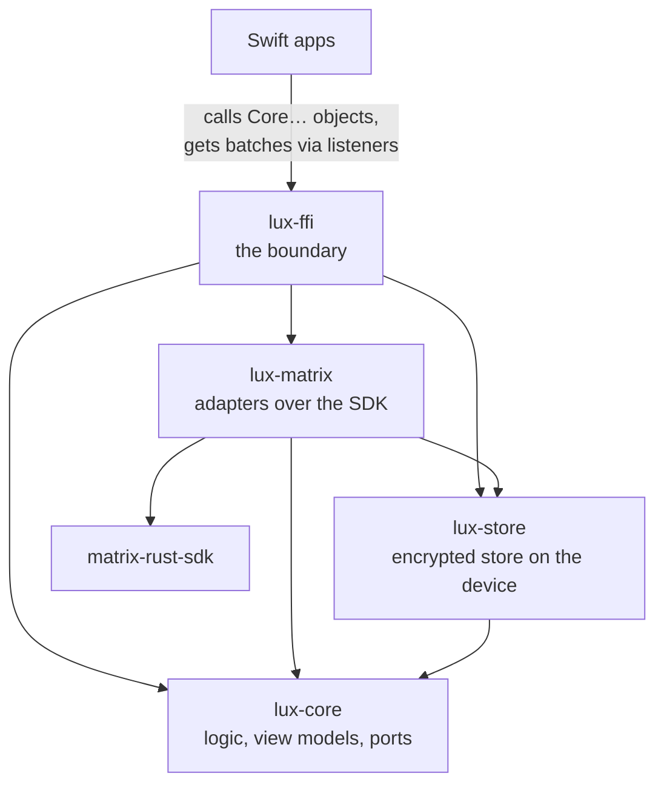
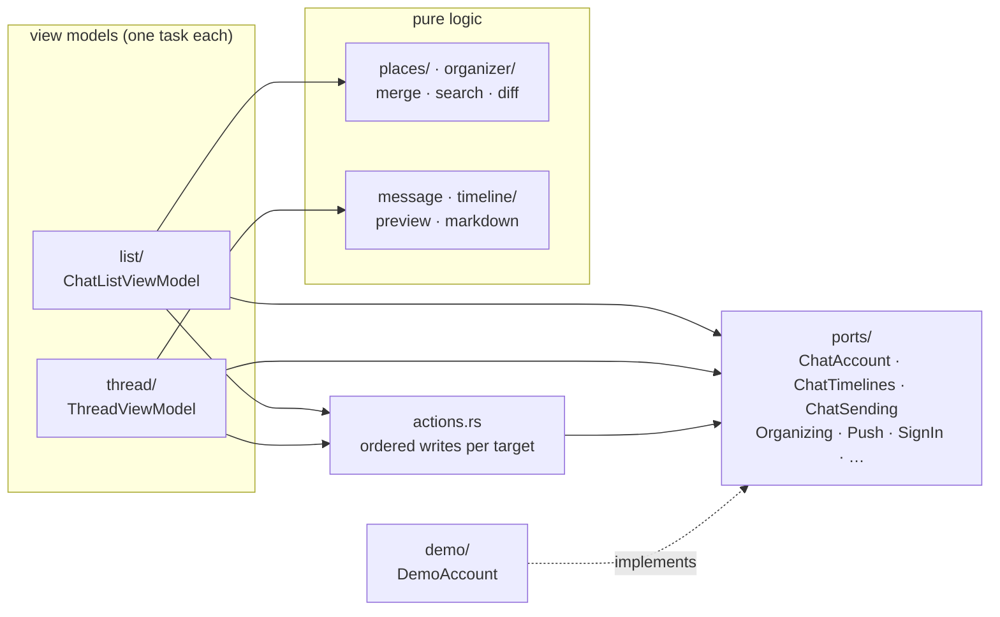
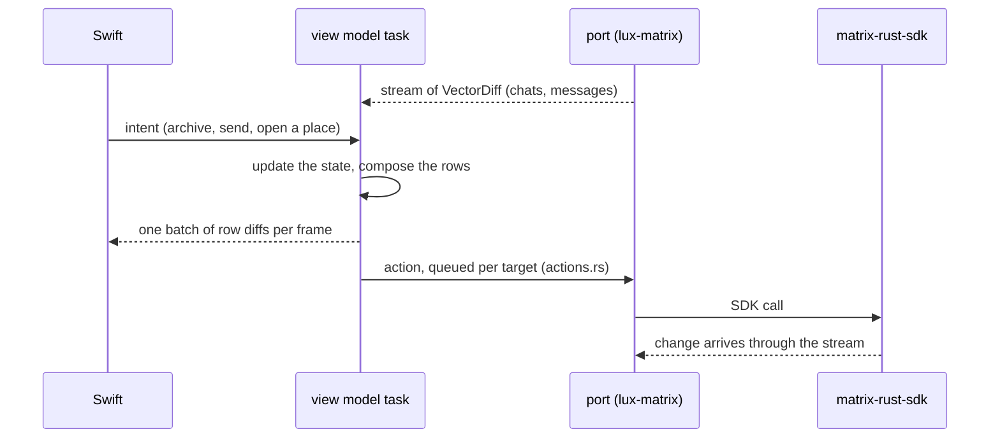

# The Rust core

Lux keeps everything but the UI in one Rust core, shared by every app: iPhone and Mac now
(UIKit, AppKit), other platforms later (see [roadmap.md](roadmap.md)). Each app draws its own
native UI over the same core, as Element X does over matrix-rust-sdk. The core is designed from
the Matrix specification and matrix-rust-sdk's public API.

This file holds the core's design: its crates and how they talk, then the rules for its code.
The app's layers, folders and data flows are in [architecture.md](architecture.md), the numbers
and how to measure them in [performance.md](performance.md), the build and check commands in
[CONTRIBUTING.md](../CONTRIBUTING.md).

## Shape

- **One Rust library per app.** Two Rust static libraries in one app duplicate the standard
  library and clash, so `lux-ffi` links everything, the SDK included.
- **Ports and adapters.** `lux-core` defines what it needs as traits (streams of `VectorDiff`s,
  async actions) and never names the SDK; `lux-matrix` implements them, the demo source too.
  Most of the core builds and tests in seconds without compiling the SDK.
- **View models live in the core.** A chat list or a thread is a Rust object that sends batches
  of row diffs to a listener; the UI renders and forwards intents. Measuring and drawing stay
  native.

## The crates and who talks to whom

Dependencies point one way: towards `lux-core`, which depends on nothing of ours and nothing of
the SDK. Swift sees only `lux-ffi`. `lux-matrix` is the only crate that names the SDK.

### What belongs where

| If the code… | it belongs in | example |
|---|---|---|
| decides what the user sees or may do, with no I/O | `lux-core` | which chats a place shows, a preview's kind, diffs |
| needs something from a backend | a trait in `lux-core/src/ports` | `ChatAccount::chats()`, `ChatSending::send_text` |
| talks to Matrix | `lux-matrix`, implementing a port | the room list mapped to chats, sending through the send queue |
| keeps data on the device beside the SDK | `lux-store` | the search index, the kept chat list |
| converts for Swift (records, enums, listeners) | `lux-ffi` | `CoreChat`, `CoreListListener` |
| words, measures or draws | Swift | "You joined", cell heights |

### Inside lux-core

- **Ports** are the only way out of `lux-core`: the view models hold an `Arc` of something that
  implements them (the Matrix account, or the demo) and never know which.
- **View models** own their state in one task: streams from the ports and intents from the app
  come in, a batch of row diffs goes out at most once a frame.
- **Pure logic** has no task and no I/O: functions and values the view models compose, tested on
  their own.

### A view model, step by step

An action's result reaches the screen the same way as any other change: through the port's
stream. The view model never patches its rows by hand after a write.

### Inside lux-matrix

Each port has one adapter; each piece of mutable state has one owning task:

| Task | Owns | Feeds |
|---|---|---|
| `Lifecycle` | the sync service, whether the stores are open | the app's pause, resume, background refresh |
| room list task | the rooms mapped to chats, the kept list | `ChatAccount::chats()` |
| organizer | the app's `com.bardav.lux.*` account data | `Organizing`, the chat list's composition |
| a timeline task per open room | that room's messages | `ChatTimelines::messages` |
| `MemberLoader` | which groups' members were asked for | the rows' collages |
| `Redecryptor` | which listed rooms asked for keys | the rows' previews and order |
| `SessionEnd` | whether the server ended the session | the app's sign-out |

## Rules for the code

- Rust 2024 edition, stable toolchain; `#![forbid(unsafe_code)]` in `lux-core`.
- Types carry meaning: the core's ids are its own `Arc<str>` newtypes (Ruma's validated types end
  in `lux-matrix`); a chat is a room or a merge (`ChatId`), a reply names a message or an event
  (`MessageRef`), their text forms only at the apps' boundary. Enums for states and networks. A
  state that cannot happen cannot be written.
- Errors are typed (`thiserror`), never strings; no `unwrap`/`expect` outside tests
  (`clippy::unwrap_used` denied). Panics are bugs.
- Async with Tokio. Live data as `Stream`s or `eyeball` observables, as the SDK uses; one task
  owns each piece of mutable state (no shared locks across await points). A thread or task the
  core starts ends with the object that owns it, never at the process's exit.
- Ownership instead of copies: `Arc` for shared immutable data, borrowing in pure functions,
  no deep clones on hot paths: the chat list shares unchanged chats as `Arc`s from the room list
  to the apps, the timeline keeps its messages as `Arc`s.
- `rustfmt`, clippy's pedantic lints with `-D warnings`. Tests check behaviour through public
  surfaces: integration tests in `tests/` (Matrix flows against `matrix-sdk-test`'s mock server),
  unit tests beside the code for real invariants, property tests (`proptest`) where an invariant
  is easy to state (`diff::changes`). Licences and advisories are not checked yet (`cargo deny`
  is planned).
- Public items documented; modules small and named after what they hold; no code nothing uses.

## Performance stays

- **Native:** layouts measured off the main thread and cached per message
  (`MessageLayoutCache`), hand-placed cells, diffable data sources that reconfigure only changed
  rows, image decoding at display size with prefetching, the 50/150 ms update throttles.
- **In Rust:** the kept chat list drawn before the account opens, snapshots prepared off the
  main thread, only changed row ids reported, the search index.
- **The boundary is crossed rarely and in bulk.** The core sends diffs (`VectorDiff`, as
  `matrix-sdk-ui`'s room list does) and whole batches, never one call per row; records are
  plain values the bindings copy once.
- **Measured, not assumed.** A change to a hot path keeps or beats the numbers in
  [performance.md](performance.md); one that is slower does not ship.
